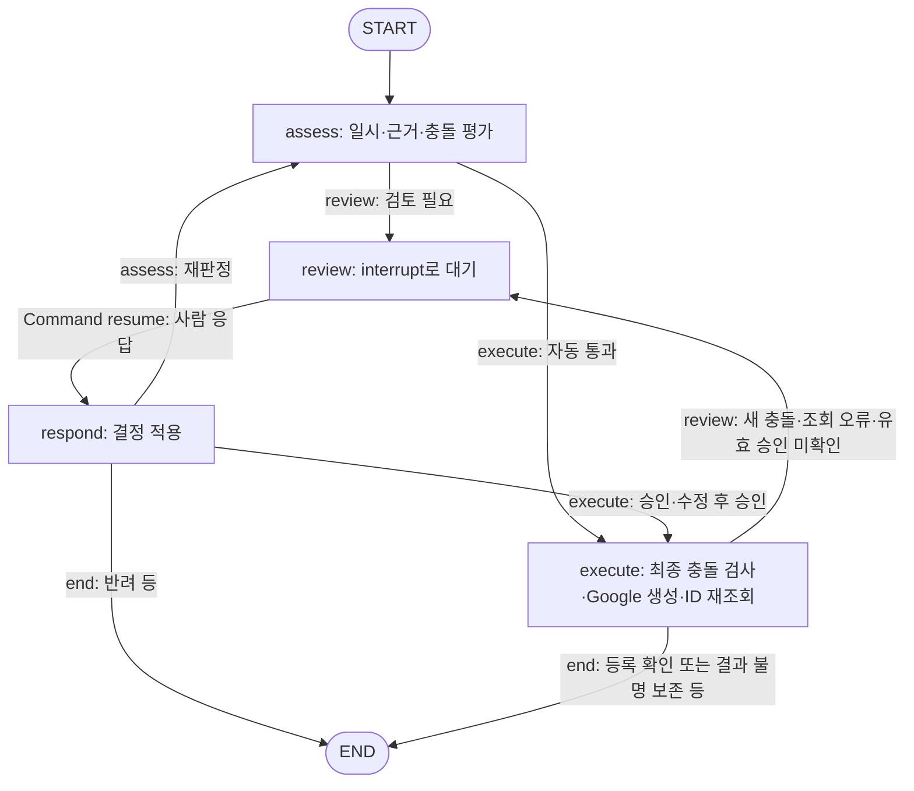
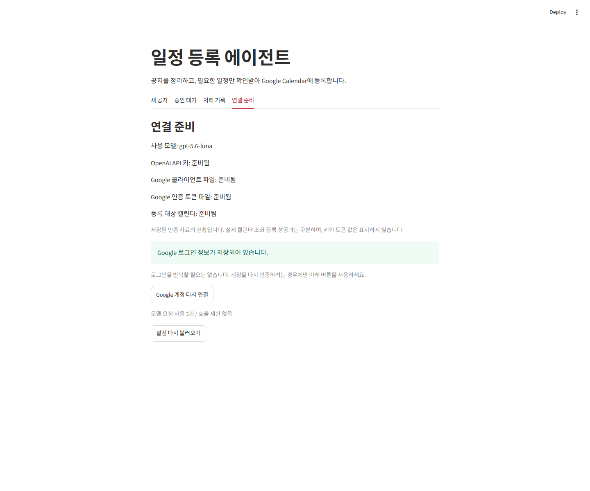
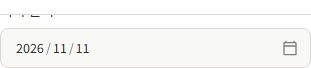
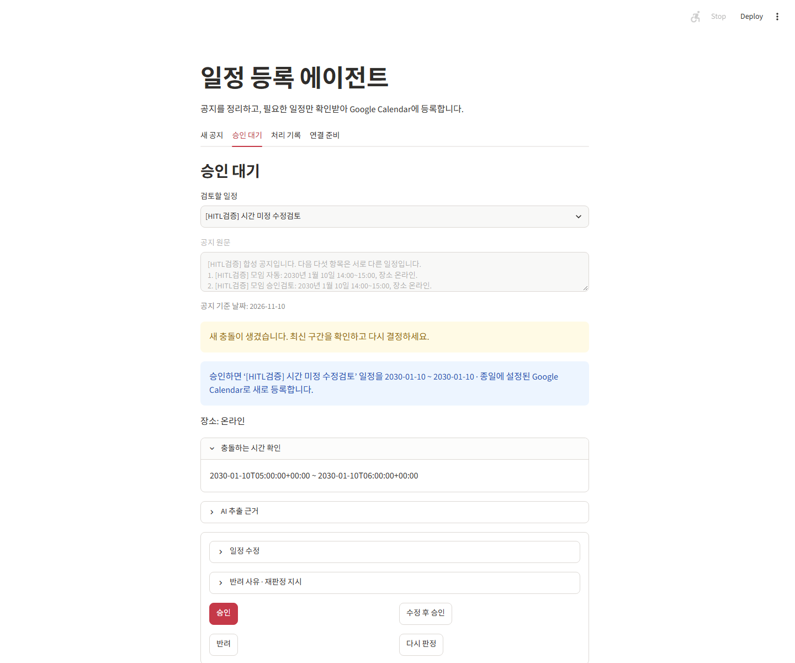
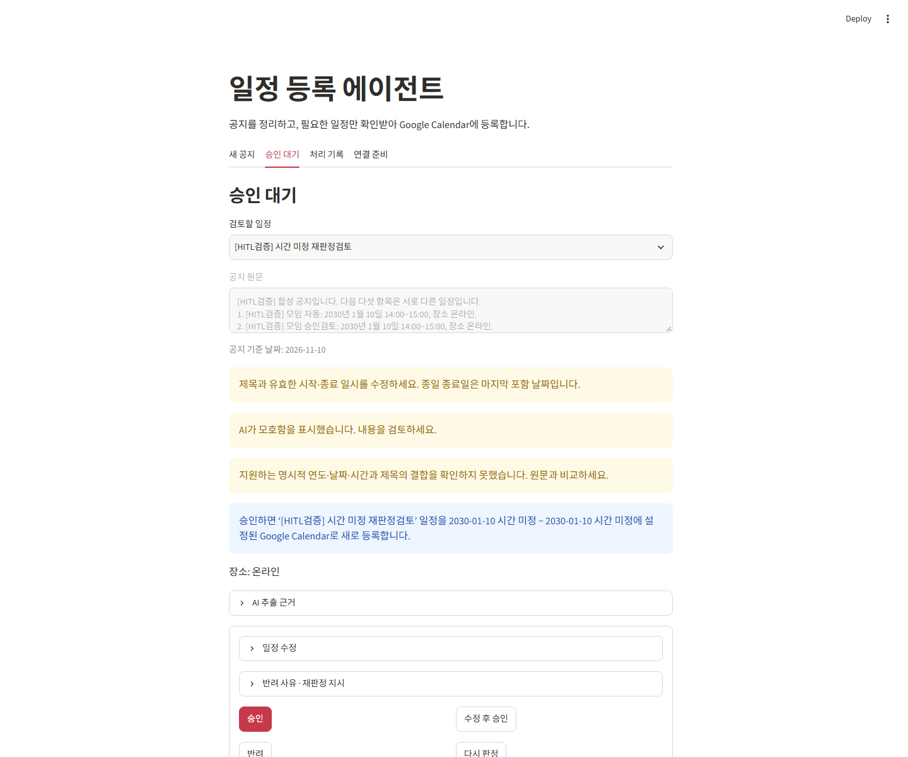
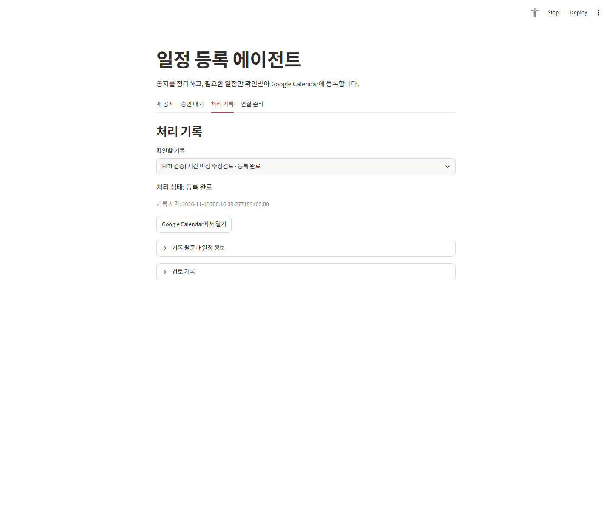
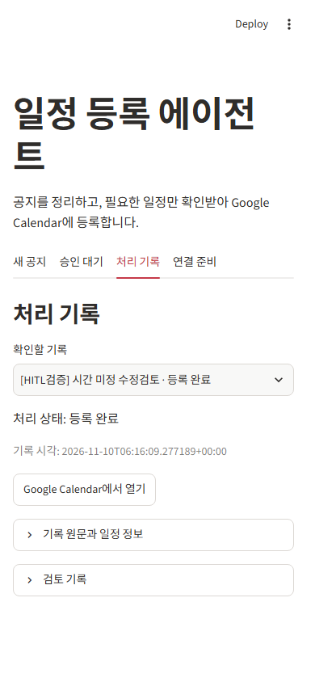
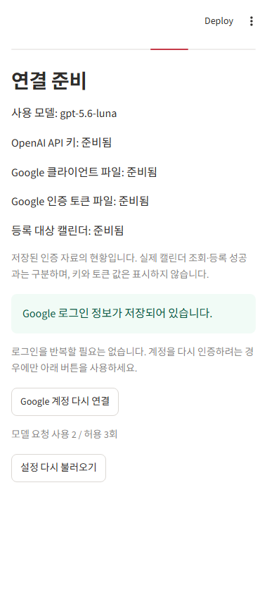

# 사람이 승인하는 일정 등록 에이전트 — 과제 보고서

> **2026-11-10 첫 합성 실연동 근거 반영.** 정상 앱에서 합성 공지 1건·5후보를 처리해 자동 등록, 승인, 수정 후 재검토·승인, 반려, 실제 모델 재판정을 확인했습니다. 최종 등록 3건은 같은 ID로 내용을 검증한 뒤 시험 생성물만 삭제했습니다. 사용자 개인 선택 이유·회고는 아래 작성 대기로 남기며, GitHub/LMS 제출 완료나 독립 사용자 평가로 주장하지 않습니다.

## 1. 주제와 고른 이유

**업무:** 붙여 넣은 공지에서 일정 후보를 추출하여 개인 Google Calendar의 `primary`에 등록합니다. 입력·검토·이력 화면만 만들고 최종 일정 저장은 Google Calendar를 사용합니다. 환불 승인은 주제에서 제외한다는 노드 조건을 따랐습니다.

**외부 반영 경계:** `GoogleCalendarAdapter.create()`의 `events.insert` 호출입니다. 그 전에 일시·근거·기존 일정 충돌을 검사하고, 위험한 후보는 `interrupt()`에서 멈춥니다. 기준을 통과한 후보는 사람 없이 자동 처리합니다. 원문 분석 자체도 OpenAI로의 외부 전송이므로 HITL이 모든 외부 전송을 차단하는 구조는 아닙니다.

**선택 이유 — 에이전트 초안:** 공지의 일시를 옮기는 반복 작업은 자동화하되, 모호한 시각이나 중복 예약은 사람의 맥락 판단을 남길 수 있는 주제입니다. 이는 구현 관점의 설명이며 학습자의 개인 경험·선택 이유를 대신하지 않습니다.

**학습자 선택 이유:** [사용자 작성/검토 대기]

## 2. 파이프라인 구조도

아래는 실제 [그래프.py](02_구현/일정도우미/그래프.py)를 설명용 한국어로 표시한 구조입니다. 같은 그래프 생성 함수를 컴파일(실행 구조로 조립)만 해 추출한 [자동 생성 Mermaid 원본](03_검증/파이프라인.mmd)의 노드 6개·연결 9개와 대조했습니다. 입력·모델 추출은 서비스가 그래프 실행 전에 담당하며, 그래프 State에는 전체 공지 대신 `job_id`, `route`, `decision`을 둡니다. 상세 후보·원문은 업무 DB에 저장합니다.

- **진입:** 공지·기준 날짜·시간대 → 준비/연결 확인 → OpenAI 구조화 추출(최대 5후보) → 후보별 작업·`thread_id` 저장 → `START`.
- **중단과 재개:** `review`에서 `interrupt(view)`로 멈추고, 서비스의 `decide()`가 같은 `thread_id`에 `Command(resume=decision)`을 전달합니다. 중단 노드는 재개 시 처음부터 실행될 수 있으므로 쓰기는 별도 `execute`에 둡니다.
- **상태 보존:** SQLite 체크포인터와 업무/전송/모델 호출 장부를 분리합니다. 누락된 중단점의 복구는 재추출·자동 재전송이 아니라 검토 재요청입니다.
- **실행 결과:** 생성 응답만으로 성공 처리하지 않고 안정적인 ID로 재조회해 내용이 일치해야 `created`입니다. 결과 불명은 `unknown`이며 `reconcile()`은 같은 ID 조회만 수행합니다.
- **응답 의미:** 승인=현재 후보 진행, 수정 후 승인=수정 후보 재검증, 반려=사유와 종료, 다시 판정=해당 후보만 재추출 후 재평가입니다. 재판정은 후보별 기본 2회 및 누적 호출 예산의 제한을 받습니다.

## 3. 승인 기준과 그 이유

현재 구현은 두 기준의 **OR**입니다. 어느 하나라도 검토 사유가 있으면 자동 등록하지 않습니다. 모델의 확신도만으로 통과시키지 않습니다.

| 기준 | 실제 계산 조건 | 대비하는 위험 | 자동 처리 가능한 조건 |
|---|---|---|---|
| A. 정보 부족·근거 불명확 | 제목·시작/종료 일시의 유효성, 원문 인용 포함 여부, 모델의 `ambiguities`, 코드의 `grounded()` 지원 범위 검사 | 없는 일시 추측, 원문과 다른 후보, 반복·교차일 표현의 잘못된 단일 일정화 | 명시적 연도·한 날짜·시작/종료 시각과 제목의 근거가 확인되는 유효 후보. 명시적 종일 날짜 범위도 별도 허용 |
| B. 기존 일정과 시간 충돌 | 후보와 `freebusy` 구간이 `start < other_end`이고 `end > other_start` | 중복 예약 | 조회 성공이며 겹치는 구간이 없는 후보. 끝과 시작이 맞닿기만 하면 비충돌 |

**예시(설계 설명용, 실제 모델 실행 결과가 아님):** “2026-12-01 일정검증모임 14:00~15:00”에서 동일 제목·일시·원문 근거가 추출되고 기존 일정과 겹치지 않으면 자동 대상입니다. “내일 오후 모임”은 검토 대상이며, 명확한 일시라도 기존 busy 구간과 겹치면 멈춥니다.

**위험과 자동 통과의 근거 — 에이전트 초안:** A는 추측으로 일시를 확정하는 위험을 줄이고 B는 일시 자체가 맞아도 생기는 예약 충돌을 별도로 막습니다. 둘 다 통과한 제한된 표현을 자동화 대상으로 삼는 것은 사람 개입을 줄이기 위한 보수적 선택입니다. 다만 정규식으로 자연어 전체의 의미를 검증할 수 없고, 조회 직후 외부에서 일정이 바뀔 수도 있으므로 무오류 보장은 아닙니다. 실행 직전 충돌을 다시 확인하며 새 충돌은 재검토합니다.

**학습자의 기준 선택·위험 우선순위 판단:** [사용자 작성/검토 대기]

유효하지 않은 일시는 단순 승인으로 우회하지 못하며 수정이 필요합니다. 사람이 확인한 수정 후보는 원문 추출과 다를 수 있으므로 사용자 수정 이력·버전·후보 해시를 남깁니다. 조회 오류를 충돌 없음으로 바꾸지 않습니다.

### 기준 비교와 지표

[규칙.py](02_구현/일정도우미/규칙.py)의 `metrics(truth, predicted)`는 비어 있지 않은 동일 길이 자료를 받습니다. 정답 `truth=True`는 사람 검토 필요, 예측 `predicted=True`는 검토로 보냄을 뜻합니다.

- **개입률:** 검토로 보낸 후보 수 / 전체 후보 수.
- **놓침:** 검토 필요 정답인데 자동 통과한 후보 수.
- **헛멈춤:** 검토 불필요 정답인데 검토로 보낸 후보 수.

분모는 모델 요청 수나 테스트 함수 수가 아니라 **일정 후보 수**입니다. 사람이 어떻게 처리했는지(승인·수정·반려·재판정)는 별도로 집계해야 합니다. 사용자 정답은 모델의 자기평가와 구분합니다.

| 동일 평가 자료에 적용한 기준 | 개입률 | 놓침 | 헛멈춤 | 상태 |
|---|---|---|---|---|
| A만 적용 | 60% | 1 | 0 | 고정 합성 사실 비교 실행 |
| B만 적용 | 20% | 3 | 0 | 고정 합성 사실 비교 실행 |
| A 또는 B(현 구현) | 80% | 0 | 0 | 고정 합성 사실 비교 실행 |
| 전부 검토(대조군) | 100% | 0 | 1 | 고정 합성 사실 비교 실행 |

근거는 [평가자료.json](03_검증/평가자료.json) v1과 실제 CLI가 만든 [평가결과.json](03_검증/평가결과.json)입니다. 실제 모델 추출 5후보의 최초 위험 코드를 고정했고, 명확한 한 건·충돌 한 건·시각 누락 세 건을 에이전트가 시나리오 기대값으로 라벨링했습니다. **학습자의 독립 정답이 아닙니다.** A/B 기준을 이 작은 동일 표본에 적용한 후처리 정책 비교이며, 기준을 끈 채 추가 생성한 실험·미공개 자료 평가·일반 업무 정확도는 아닙니다. 사용자 자료의 라벨 타당성 검토는 남아 있습니다.

## 4. 실행 결과

### 실제 실행 조건과 결과

시험 시점은 2026-11-10, 모델은 `gpt-5.6-luna`, 대상은 사용자가 선택한 개인 기본 캘린더 `primary`입니다. `[HITL검증]` 제목의 2030-01-10 합성 자료를 사용했습니다. 검토 화면의 조작자도 에이전트이며, 사용자가 직접 판단한 것으로 쓰지 않습니다. 최초 분석 1회·모델 누적 3회·시험 생성 최대 5건의 승인 범위에서 실행했습니다.

| 항목 | 확인 결과 | 근거와 한계 |
|---|---|---|
| 공지 / 후보 / 최초 자동 / 최초 검토 | 1 / 5 / 1 / 4 | 정상 웹 입력부터 실제 모델 추출·그래프까지 실행 |
| 모델 전송 예약 | 분석 1 + 재판정 1 = 2회, 허용 3회 | 실제 응답 검증 성공. 앱 장부 수치이며 제공자 청구·HTTP 패킷 독립 감사는 아님 |
| 최종 업무 상태 | `created` 3, `rejected` 2, `needs_review`·`unknown` 0 | 후보 5개 기준. 재판정·재검토 클릭을 추가 후보로 합산하지 않음 |
| 실제 Google | 생성 3, 고유 ID 내용 재조회 일치 3, 반려 ID 부재 2 | 제목·시작·종료·종일 구간·전송 payload 일치 확인 |
| 실제 대기 복원 | 서버 종료·재기동 전후 대기 4건 ID·버전·상태 및 장부 5/1/1 불변 | 복원 확인 중 모델·Google 쓰기 0 |
| 시험 정리 | 정확한 생성 ID 3개만 삭제, 소유 ID 5개 전부 부재 재조회 | 업무·호출·전송 장부 보존, 남은 시험 일정 0 |
| 오프라인 | 예상=실행 76, 실패·오류·skip 0, 소스 안정성 | 백엔드 47 + 화면 17 + 소비자 통합 10 + 평가 2. 외부 SDK는 대역 |
| 최종 실제 화면 | 생성 기록·결정 이력·새로고침 보존, 빈 대기, 390px 표시·하단 버튼 접근 | 신규 제공자 동작 없음, 장부 5/2/3 불변, 콘솔 오류 없음 |

공개 근거는 [실행결과.json](03_검증/실행결과.json), [회귀검사.json](03_검증/회귀검사.json), [화면검사.json](03_검증/화면검사.json)입니다. 원시 로그·실제 ID·계정·인증 자료는 공개하지 않았습니다. 시험 정리 뒤 `created`는 **당시 생성 내용이 확인된 이력**이지 현재 Google에 그 이벤트가 남아 있다는 뜻이 아닙니다.

### 중단된 네 후보의 실제 처리

| 합성 후보 | 중단 이유 | 실제 화면 조작과 결과 |
|---|---|---|
| 모임 승인검토 | 이미 자동 등록한 일정과 14:00~15:00 충돌 | 충돌 구간 확인 후 승인 → 같은 일시의 별도 일정 생성·재조회 |
| 시간 미정 수정검토 | 필수 시각 누락 | ‘종일 일정’으로 명시 수정 후 승인 제출 → 새 충돌을 보여 주고 다시 멈춤 → 그 내용을 별도 승인 → 2030-01-10 종일 등록. Google의 배타적 종료 날짜는 2030-01-11 |
| 시간 미정 반려검토 | 필수 시각 누락 | 사유 입력 후 반려 → 전송 장부 없음·Google ID 부재 |
| 시간 미정 재판정검토 | 필수 시각 누락 | 실제 모델에 해당 후보만 재판정 1회 → 시각 미해결이라 대기 유지 → 사유 입력 후 반려·Google ID 부재 |

기록된 결정은 `approve` 2, `edit_pending_review` 1, `reject` 2, `rejudge` 1입니다. 수정 사례는 새 충돌을 발견했으므로 곧바로 `edit_approve` 성공으로 기록하지 않고 **수정 보존·재검토 후 승인**으로 남겼습니다. 최종 후보 수는 여전히 5입니다. 승인 전에는 해당 후보의 전송 장부가 없었고, 반려 두 건은 실제 Google 조회에서도 부재를 확인했습니다.

### 발견된 실패와 한계

최종 파서 보완 뒤 새 모델 요청·일정 생성은 하지 않았습니다. 앞선 실제 정상 실호출과 최종 코드의 SDK 대역/저장 후보 내용 재생을 구분합니다. 재생한 5후보 내용은 실제 저장 자료지만 SDK 응답 봉투는 합성이며 원시 제공자 응답 기록이 아닙니다. 잘못된 응답 세 시험은 행동 RED를 확인했고 추가 소비자·재생 검사는 보완 뒤의 검증 사례입니다.

- 원 독립 검토는 Standards 통과 / Spec 수정 필요 2건으로 보존했습니다. 부모가 반복 일정 오자동 처리와 시간대 오류 경계를 재현·보완했습니다. **원 판정을 수정 후 독립 PASS로 바꾸지 않습니다.** 최종 독립 검토는 CAL-03 조건부 응답 형식 오류로 Standards/Spec 모두 수정 필요였습니다. 부모가 SDK HTTP 대역에서 세 행동 RED→GREEN을 관찰하고 서비스→화면의 공개 오류·예약·실패 이력·쓰기 없음을 검사했습니다. 최종 76개와 실제 서비스 재조립·Google 읽기·화면 재검증은 부모의 근거이며 독립 재검토 PASS가 아닙니다. [검토 조치 기록](03_검증/검토조치.json)을 따릅니다.
- 한국어 시험 파일을 단순 discovery가 누락한 문제와 상속 `PYTHONPATH` 혼입이 있었습니다. 제공 명시 로더·프로젝트 Python `-I` 실행으로 구분했으며, 0개 수집·import 실패를 행동 테스트의 RED 또는 통과로 세지 않았습니다.
- 로그인 후 같은 연결 버튼만 보이던 화면은 저장 안내·다시 연결 구분으로 보완했고 실제 새로고침 유지도 확인했습니다. 초기 만료 인증의 한 번 갱신·성공 자료 저장·실패 파일 보존도 추가 검사했습니다. 로그인 저장 안내와 실제 API 성공은 계속 구분합니다.
- 브라우저 검사기의 선택기 DOM 가정과 마우스 동작, 전송 중 일시적 `unknown`을 최종 실패로 읽는 문제, DB 저장 완료와 화면의 후속 rerun 완료를 같은 시점으로 보는 문제가 있었습니다. 실제 장부를 먼저 읽어 성공한 등록을 반복하지 않았고, 최신 문서/폼을 새로 열어 남은 결정만 이어서 검사했습니다. 이를 모델 실패·유료 재요청 수로 집계하지 않았습니다.
- 현재는 기준일로 계산할 수 있는 오늘·내일·모레의 단일 날짜를 지원하며, 시작 전용 표현·이번/다음 주·복합 범위·연도 생략·반복·교차일 시간의 자동 해석은 제한합니다. 보수적인 검사로 헛멈춤이 생길 수 있고, 실모델 추출 품질·실제 자료의 오류율은 아직 산정하지 않았습니다.
- 쓰기 후 응답 유실·내용 불일치는 `unknown`으로 보존합니다. 자동 재등록을 막는 대신 사용자에게 결과 확인이 남을 수 있습니다. 다중 프로세스·다중 사용자 운영 및 오래된 대기 건의 기한 정책은 미지원/미정입니다.

### 사용자 후속 요청: 누적 호출 제한 제거

첫 실험 뒤 사용자가 “호출 제한 없애 그냥;”라고 요청하여 `LLM_CALL_LIMIT=unlimited`(내부 None)를 적용했습니다. 기존 호출 3회는 지우지 않고 횟수로 더 이상 막지 않습니다. 기본 설정·저장소·readiness·화면을 함께 수정했고, 실제 화면에서 호출 제한 없음·분석 버튼 활성화·경고 제거를 확인했습니다. 기존 업무/호출/전송·체크포인트·인증은 보존했고 추가 모델·Calendar 실호출은 없었습니다. 네 행동 RED→GREEN과 전체 81개 검사를 확인했습니다. 기존 76개·모델 2회·등록 3건은 이전 합성 검증 기록이며 후속 사용자 사용을 포함한 현재 전체 통계로 바꾸지 않습니다. [후속 적용 근거](03_검증/호출제한해제.json).

### 후속 사용 오류 수정: 내일과 내일부터

모델에 기준 날짜가 이미 전달돼도 지시/검증이 상대 날짜를 일괄 거부해 날짜를 미정으로 남겼습니다. 기준일 `2026-11-10`의 오늘·내일·모레는 코드로 각각 10일·11일·12일을 계산하도록 바꾸고 모델 추출/재판정 지시와 검증을 연결했습니다. 명확한 단일 날짜와 시작 전용 표현을 구분하며, 실제 원래 사례는 ‘내일부터’였으므로 시작 날짜만 `2026-11-11`로 보완했습니다. 이 상대 날짜 수정 당시에는 종료 날짜/시각을 미정으로 유지했습니다. 이후 사용자 확정 정책에 따라 아래의 당일/1시간 기본값을 별도로 적용했습니다. 정정 전 날짜는 이력에 남기고 새 버전을 원자 갱신하여 오래된 화면이 승인하지 못하게 했습니다.

기존 다른 작업·모델/전송 장부·체크포인트·설정/인증은 보존했고, 새 유료 모델·Calendar 요청은 없었습니다. 최종 101개와 실제 저장·날짜 컨트롤/설명·종료 빈값·호출 제한 없음 표시를 확인했습니다. [후속 수정 근거](03_검증/상대날짜수정.json).

### 후속 확정 정책: 종료 누락의 당일/1시간

사용자가 종료 정보가 없을 때 시간 일정은 1시간, 종일 일정은 시작일 당일을 기본값으로 쓰도록 지정했습니다. 이 값은 원문의 사실이 아니라 사용자 정책으로 기록합니다. 평가·승인·수정 후 승인 전에 적용하여 종료 정보를 재입력하지 않고 처리할 수 있게 했고, 원문 명시 종료 정보는 보존합니다. 완성된 동일 구간으로 충돌을 다시 확인하며 새 충돌은 재검토합니다. 기본값 자체에 추가 체크박스나 모델 재판정을 요구하지 않습니다.

기존 실제 문제 대기 건의 누락 종료값만 v4→v5와 이력으로 저장했고, 시작 날짜·다른 작업·모델/전송·체크포인트·인증은 보존했습니다. 실제 정상 앱에서 종료 날짜/시각·기본값 안내·승인 활성과 누적 제한 없음을 확인했습니다. 시간 일정/종일의 실제 화면→서비스→SQLite/LangGraph 승인은 외부 제공자 대역으로 검사했고, 이번에 실제 Calendar에 등록하거나 새 모델을 호출하지는 않았습니다. 최종 118개 통과. [현재 근거](03_검증/종료기본값수정.json).

## 5. 데모 화면 설계

[앱.py](02_구현/앱.py)는 Streamlit의 네 탭을 사용합니다.

| 화면 | 보여 주는 것 | 제외하거나 제한한 것 |
|---|---|---|
| 새 공지 | 원문, 기준 날짜, 준비 부족 안내, 실제 등록까지 진행하는 분석 버튼, 후보별 상태 | 메일·메신저 자동 수집, 별도 월간 캘린더 |
| 승인 대기 | 건별 목록, 원문·일시·장소·AI 인용 근거·모호함·멈춘 이유·충돌 구간·승인 시 결과 | 기존 일정 제목/본문, 불필요한 장식, 비밀값 |
| 네 응답 폼 | 승인, 일정 수정 후 승인, 사유 있는 반려, 지시 있는 재판정 | 오래된 버전 승인과 수정 내용을 무시한 단순 승인 차단 |
| 처리 기록 | 실제 상태, 공개 오류 메시지, 원문/후보/결정 이력, 확인된 Google 링크, `unknown`의 같은 ID 조회 버튼 | 결과 불명을 성공으로 표시하거나 새로 생성하는 버튼 |
| 연결 준비 | 키/파일/대상 준비 여부, 로그인 저장 안내, 명시적 연결·설정 재로드, 호출 사용/상한 | 키·토큰 원문, 파일 업로드, 새로고침 자동 로그인 |

판단에 필요한 정보를 한 건에서 볼 수 있도록 설계했지만 **10초 안에 판단한다는 사용자 실측은 하지 않았습니다.** 충돌 시간·처리 이력 일부는 UTC ISO 문자열로 표시되므로 사용자 시간대의 읽기 쉬운 표현은 후속 개선 후보입니다.

**실제 캡처:** 합성 시험 자료만 사용했고 각 원본을 시각 확인했습니다. 공개 사본 5개의 바이트/해시가 원본과 일치합니다. 아래 이미지의 보이지 않는 원문·접힌 상세까지 캡처로 확인했다고 주장하지 않습니다.

1. **수정 뒤 새 충돌 재검토.** 종일 구간과 새 충돌, 승인 시 생성할 내용, 네 응답을 보여 줍니다.

2. **재판정 후 대기 유지.** 날짜는 있지만 시각은 여전히 미정입니다. 하단 일부는 캡처 밖이며, 최종 반려·부재는 실행 기록에서 별도 확인했습니다.

3. **수정 후보의 등록 확인 이력.** 선택된 기록과 등록 상태·Google 열기 버튼을 확인했습니다. 시험 이벤트는 이후 정리됐습니다.

4. **390px 처리 기록.** 주요 상태·버튼은 가려지지 않습니다. 큰 제목 마지막 글자의 줄바꿈은 조판 보류 항목입니다.

5. **390px 연결 준비 하단.** 로그인 저장 상태와 모델 사용 2/허용 3, 설정 재로드 버튼을 확인했습니다. 키·토큰 값은 없습니다.

## 6. 프로젝트 회고

### 에이전트의 사실 관찰 — 사용자 회고 아님

- 외부 쓰기를 중단 노드와 분리하고, 대기 상태·사람의 결정·전송 결과를 각각 보존하는 부분에 안전장치를 두었습니다.
- SDK 형식 통과, 오프라인 분기 통과, Google 로그인, 실제 생성·재조회·정리는 서로 다른 증거로 남겼습니다. 성공한 외부 요청 뒤 검사기만 실패한 경우에는 같은 ID 조회로 이어가 중복 등록하지 않았습니다.
- 수정하면 무조건 등록하는 대신 새 충돌을 다시 보여 주는 경로에 공을 들였습니다. 실제 수정 사례도 이 경로로 멈춰 별도 승인을 받아야 했습니다. 업무/체크포인트/전송 장부를 분리해 재시작과 외부 결과 불명도 구분했습니다.
- 다음 개선 후보는 실제 업무 자료의 독립 라벨 평가, 오래된 대기 건의 운영 정책, 시간대 표시와 좁은 창 제목 조판입니다. 채택 여부는 사용자 판단이 필요합니다.

### 학습자 회고

- 가장 공들인 부분과 그 이유: **[사용자 작성/검토 대기]**
- 직접 이해·수정·판단한 부분: **[사용자 작성/검토 대기]**
- 실험 실패에서 배운 점: **[사용자 작성/검토 대기]**
- 앞으로 보완하고 싶은 점과 우선순위: **[사용자 작성/검토 대기]**

## 루브릭 대응과 제출 상태

| 원문 루브릭 | 문서/구현 대응 | 남은 증거 |
|---|---|---|
| 웹 데모와 제출물의 완결성 | 실제 앱의 처리·수정·재판정, 실행 안내·구조도·실행/정리 근거·화면 5장 | 사용자 회고·문서 최종 확인·GitHub URL·LMS 제출 |
| 승인 기준 설계의 타당성 | 계산 가능한 A/B와 위험 설명, 자동 사례, 같은 합성 5후보의 네 기준 비교 | 사용자 선택 이유·실제 업무 자료의 독립 라벨 평가 |
| HITL 파이프라인 구현의 정확성 | 실제 자동 생성·검토 후 생성·미해결 재판정 대기·반려 부재·재시작 복원·ID 내용 확인 | 소량 합성 검증의 범위를 넘는 일반 신뢰성은 보장하지 않음 |

**GitHub URL:** [미제출 — 공개 범위와 업로드 승인 후 입력]

**LMS 제출:** 사용자 최종 확인 대기. 공개 웹 호스팅은 필수가 아니며 로컬 실행과 코드 저장소 제출은 구분합니다.

## 근거와 출처

- 원 노드: 「에이전트 팀 꾸리기_Agt2 / 9.사람이 승인하는 에이전트 만들기 [프로젝트]」, 보존된 `🔍 2026-11-09 본문과 코드 원문.md`의 프로젝트 안내 435~480행·루브릭 491~503행, `📝 2026-11-09 사람이 승인하는 에이전트 전체 강의 정리.md`를 읽었습니다. 보존본은 제출 저장소 밖에 있으므로 끊긴 로컬 링크를 만들지 않았습니다.
- [LMS 프로젝트 안내](https://learn.modulabs.co.kr/camp/147/courses/2326/node-version/6242/steps/31600) / [LMS 제출·루브릭](https://learn.modulabs.co.kr/camp/147/courses/2326/node-version/6242/steps/project): 보존본 기준이며 이 문서 작업에서 다시 접속하거나 제출하지 않았습니다.
- [작업 명세서](<01_설계/📘 작업 명세서.md>) 4~8절 / [기술 명세서](<01_설계/📘 기술 명세서.md>) / [진행 현황](<01_설계/📋 진행 현황.md>) / [CHANGELOG](CHANGELOG.md): 승인된 요구사항·계약·기존 검증 이력. 과거 시점의 준비 전 문장은 최신 승인과 별도로 구분했습니다.
- [실행 안내](README.md), [서비스.py](02_구현/일정도우미/서비스.py), [그래프.py](02_구현/일정도우미/그래프.py), [규칙.py](02_구현/일정도우미/규칙.py), [테스트실행.py](02_구현/테스트실행.py): 실제 공개 동작·상태 전이·지표·시험 기록 방식.
